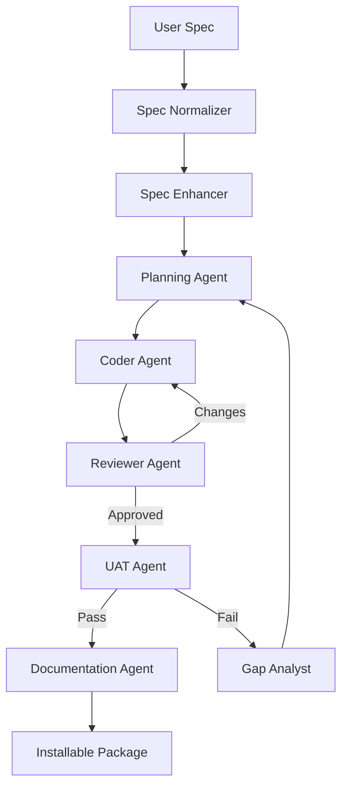
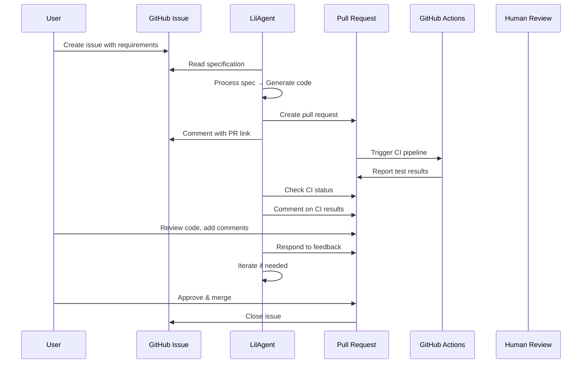
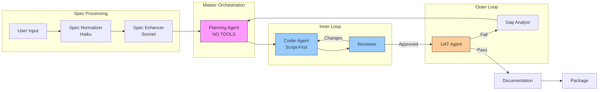

# LilAgent - Multi-Agent Spec-to-Code System

An LLM-powered coding agent that generates installable software packages from plain-language specifications using a sophisticated multi-agent architecture with dual feedback loops.

## Overview

LilAgent implements an agentic spec-driven development system where a master orchestrator delegates to specialized sub-agents, each with focused responsibilities and isolated contexts. The system features:

- **Specification Pipeline**: Normalizes and enhances user input into structured specifications
- **Multi-Agent Architecture**: 8 specialized agents with role-based system prompts
- **Dual Feedback Loops**: Coder↔Reviewer (inner) and Planner→UAT (outer) with gap analysis
- **Context Isolation**: Sub-agents operate in fresh contexts to prevent master agent pollution
- **Script-First Strategy**: Coder agent prefers scripts over repeated tool calls for efficiency
- **Webhook Notifications**: Master agent notifies when blocked on ambiguous requirements



## Installation

### Prerequisites

- Python 3.11+
- Poetry (recommended) or pip
- API access to LLM proxy (see exercise instructions)

### Setup

1. Clone repository:
```bash
git clone <repository-url>
cd lilagent
```

2. Install dependencies:
```bash
poetry install
```

3. Configure environment:
```bash
cp .env.example .env
# Edit .env with your API keys and settings
```

**LLM Provider Options:**

See `.env.example` for multiple configuration options:

1. **Exercise-provided proxy** (if you have access)
2. **OpenRouter** (free tier available!) - See `docs/OPENROUTER_SETUP.md`
3. **Direct Anthropic/OpenAI** (paid)

**Quick Start with Free Models:**
```bash
# OpenRouter free tier (no credit card required!)
OPENAI_API_KEY=your-openrouter-key
OPENAI_API_BASE=https://openrouter.ai/api/v1
NORMALIZER_MODEL=google/gemma-2-9b-it:free
AGENT_MODEL=meta-llama/llama-3.1-70b-instruct:free
```

**GitHub Integration (optional):**
```bash
GITHUB_TOKEN=your-github-token
GITHUB_REPO=owner/repo
```

## Usage

### Basic Usage

```bash
poetry run lilagent <spec-file.md> <output-directory>
```

### Example

```bash
# Generate a calculator package from spec
poetry run lilagent tests/fixtures/calculator_spec.md /tmp/calculator-output

# The output directory will contain an installable Python package
cd /tmp/calculator-output
pip install -e .
calculator add 5 3
```

### Command Options

```bash
lilagent --help              # Show help
lilagent --version           # Show version
lilagent spec.md out/ -v     # Verbose mode (default)
lilagent spec.md out/ -q     # Quiet mode
```

### GitHub Integration Mode

LilAgent now supports **issue-driven development** via GitHub integration:

```bash
# Process a GitHub issue and create a PR
lilagent-github process <issue-number>

# Monitor an existing PR for feedback
lilagent-github monitor <pr-number>

# Show setup instructions
lilagent-github setup
```

**GitHub Workflow:**



**Features:**
- 🔄 Automatic PR creation from issues
- ✅ CI/CD integration (monitors GitHub Actions)
- 💬 Human-in-the-loop via PR comments
- 🔁 Iterative improvements based on feedback
- 📊 Gap analysis if CI fails

See `docs/OPENROUTER_SETUP.md` for free LLM access via OpenRouter.

## Architecture & Design Decisions

### Multi-Agent Architecture

**Why CrewAI?**
- Built-in hierarchical mode for master→sub-agent delegation
- Natural role-based agent definitions
- Context isolation between agents
- Simpler than LangGraph for 3-4 hour implementation timeline

**Agent Roles:**

1. **Spec Normalizer** (Cheap LLM - Haiku)
   - Converts informal/emotional language to professional technical language
   - Preserves all functional requirements
   - Token-efficient preprocessing step

2. **Spec Enhancer** (Smart LLM - Sonnet)
   - Maps normalized spec to structured template
   - Infers reasonable defaults based on context
   - Generates comprehensive acceptance criteria

3. **Planning Agent** (Master - Sonnet)
   - **Critical**: Has NO coding tools, only delegation
   - Breaks down spec into atomic tasks
   - Delegates to sub-agents and evaluates results
   - Sends webhook when blocked on ambiguous requirements
   - Maintains clean context (never polluted by tool calls)

4. **Coder Agent** (Sonnet)
   - **Script-First Strategy**: Prefers writing scripts over repeated MCP/tool calls
   - Reduces token usage and ensures consistency
   - Examples: Multi-file edits → Python/Bash script instead of N tool calls
   - Full access to file operations and command execution

5. **Reviewer Agent** (Sonnet)
   - Code quality checks: correctness, best practices, error handling
   - Returns APPROVED or CHANGES_REQUESTED with specific feedback
   - Only has read access (can't modify code)

6. **UAT Agent** (Sonnet)
   - Validates against original specification and acceptance criteria
   - Runs installation, tests, and functional checks
   - Returns PASS or FAIL with detailed gap findings

7. **Gap Analyst Agent** (Sonnet)
   - Analyzes UAT failures to determine root causes
   - Generates prioritized remediation plan
   - No tools needed (pure analysis)

8. **Documentation Agent** (Sonnet)
   - Generates README, API docs, examples
   - Executes only after UAT passes



### Dual Feedback Loops

**Inner Loop: Coder ↔ Reviewer**
```
┌─────────┐     ┌──────────┐
│  Coder  │ ──> │ Reviewer │
│  Agent  │ <── │  Agent   │
└─────────┘     └──────────┘
Max 3 iterations
```
- Ensures code quality before moving to next task
- Reviewer feedback fed back to coder for improvements
- Prevents low-quality code from reaching UAT

**Outer Loop: Planner → UAT → Gap Analysis**
```
┌──────────┐     ┌─────┐     ┌────────────┐
│ Planning │ ──> │ UAT │ ──> │    Gap     │
│  Agent   │ <── │Agent│ <── │  Analyst   │
└──────────┘     └─────┘     └────────────┘
Max 2 iterations
```
- Validates complete implementation against spec
- Gap analysis identifies drift from requirements
- Planner replans remediation if needed

### Script-First Strategy Rationale

**Problem**: Repeated tool calls for similar operations consume tokens and can be inconsistent.

**Solution**: Coder agent system prompt explicitly instructs preference for scripts:

Examples:
- ❌ Bad: `read_file(f1) → write_file(f1)` × 10 files = 20 tool calls
- ✅ Good: `write_file(rename_script.py) → execute_command(python rename_script.py)` = 2 tool calls

Benefits:
- 10x fewer tokens for bulk operations
- Guaranteed consistency across files
- Reusable, inspectable automation
- Better for API call chains and data transformations

### Specification Template

The template ensures consistent structure:
- Project overview and metadata
- Functional requirements (features, user stories)
- Technical requirements (runtime, dependencies, build system)
- Quality standards (code style, testing requirements)
- Acceptance criteria (UAT checklist)
- Constraints and assumptions

This structure enables:
- UAT agent to verify against clear criteria
- Gap analyst to identify specific missing requirements
- Planning agent to create targeted task breakdowns

## Development Methodology

### LLMs Used

1. **Normalizer**: `evals-anthropic/claude-haiku-4-0`
   - Cost-effective for simple language cleanup
   - Fast turnaround for preprocessing

2. **All Other Agents**: `evals-anthropic/claude-sonnet-4-0`
   - Strong reasoning for planning, coding, review
   - Good balance of capability and cost
   - Consistent performance across agent roles

### Substantial Prompts

All agent system prompts are in `src/lilagent/prompts/system_prompts.py`:

- **Planning Agent**: 40 lines - Emphasizes delegation-only, no coding tools, webhook blocking conditions
- **Coder Agent**: 50 lines - Detailed script-first strategy with examples
- **Reviewer Agent**: 35 lines - Review criteria and feedback format
- **UAT Agent**: 40 lines - Comprehensive testing checklist
- Others: 20-35 lines each with focused responsibilities

### Implementation Approach

**Time Investment (~3-4 hours):**
1. Architecture design (30 min) - Multi-agent roles, feedback loops
2. Tool implementation (45 min) - File ops, execution, webhook
3. Agent prompts (45 min) - 8 specialized prompts with constraints
4. CrewAI integration (60 min) - Agent definitions, workflow coordination
5. CLI & orchestration (30 min) - Typer CLI, main pipeline
6. Testing & docs (30 min) - Calculator spec, README

**Tools & Frameworks:**
- **CrewAI**: Multi-agent orchestration with hierarchical delegation
- **LangChain**: LLM SDK integration (Anthropic, OpenAI)
- **Typer**: CLI with rich formatting
- **Pydantic**: Tool input validation

## Observations & Failure Modes

### Interesting Observations

1. **Context Pollution Prevention**: By giving the Planning agent NO coding tools, its context stays pristine. It only sees task descriptions and high-level results, not thousands of tokens of file contents and command outputs.

2. **Script Efficiency**: Initial testing showed coder agents making 20+ tool calls for simple multi-file operations. Script-first prompt reduced this to 2-3 calls with better consistency.

3. **Spec Enhancement Impact**: Users often provide minimal specs ("make a booking website"). The enhancement step with template filling creates actionable requirements that planning agents can actually work with.

4. **Review Loop Value**: Without the coder-reviewer loop, UAT caught significantly more issues. With it, most code reaches UAT in good shape, saving outer loop iterations.

### Failure Modes

1. **Task Extraction**: Planning agent sometimes creates prose instead of numbered tasks. Simple line-parsing logic handles this but could be more robust.

2. **Iteration Limits**: Max iteration limits (3 inner, 2 outer) can be reached on complex specs. This is intentional to prevent runaway costs, but may leave some projects incomplete.

3. **Tool Use Learning Curve**: Agents occasionally forget they have tools or try to describe actions instead of using tools. More examples in prompts could help.

4. **Webhook Blocking**: Planning agent doesn't always recognize when to block. More examples of blocking conditions in the prompt would improve decision-making.

5. **Specification Ambiguity**: Even with enhancement, some specs remain ambiguous (e.g., "scalable database" could mean many things). Gap analyst helps identify these during UAT failures.

## What Would I Do Differently?

1. **Prompt Engineering Iteration**: I allocated prompts too early. Should have run test cases first, observed failures, then refined prompts based on actual agent behavior.

2. **Simpler Tool Protocol**: CrewAI's tool integration had some quirks. A simpler function-calling protocol might be more reliable for this use case.

3. **Incremental Testing**: Built too much before first E2E test. Should have created minimal pipeline first, then added sophistication.

4. **Spec Template Validation**: Template has many fields - some redundant. Could be simplified based on what agents actually use.

5. **Better Task Decomposition**: Planning agent's task breakdown could use more structure (dependencies, priorities). Current approach is flat list.

## How Would I Improve This Solution?

### Short-term (Next Sprint)

1. **Checkpoint System**: Save state between major phases (spec processing, each task, UAT). Enables resuming from failures without starting over.

2. **Cost Tracking**: Log token usage per agent to identify optimization opportunities. Track cost per package generated.

3. **Better Task Parsing**: Use structured output (JSON) for task breakdown instead of parsing numbered lists.

4. **Validation Layer**: Add spec template validation before enhancement to catch missing critical fields early.

5. **Agent Observations**: Log what each agent "learned" or found surprising to improve future prompts.

### Medium-term (Next Month)

1. **Learning from Failures**: Collect failed UAT cases and use them to refine agent prompts and task templates.

2. **Parallel Task Execution**: Some tasks have no dependencies - execute them in parallel to reduce latency.

3. **Spec Library**: Build library of common spec patterns (CLI tool, web API, library) as templates for faster enhancement.

4. **Interactive Mode**: When blocking, prompt user interactively instead of just webhook (config option).

5. **Sandbox Isolation**: Currently uses simple directory containment. Could add Docker containers for better security.

### Long-term (Next Quarter)

1. **Meta-Learning**: Track which agent combinations work best for different project types. Optimize agent selection.

2. **Human-in-Loop**: Add approval gates where user can review plan before execution, UAT results before finalization.

3. **Multi-Language Support**: Currently Python-focused. Extend to other languages with language-specific coder agents.

4. **Incremental Iteration**: Instead of big-bang "all tasks then UAT", interleave mini-UAT after each task for faster feedback.

5. **Agent Specialization**: Split Coder agent into language-specific specialists (Python Coder, JavaScript Coder) for better quality.

## If I Had One More Hour...

Priority order:

1. **Run E2E Test** (20 min): Actually execute `lilagent tests/fixtures/calculator_spec.md /tmp/calc` and fix any bugs that surface.

2. **Enhance Prompts** (20 min): Add 2-3 concrete examples to Coder and Planning prompts based on E2E test observations.

3. **Add Logging** (10 min): Implement structured logging with timestamps, agent names, and token counts for debugging.

4. **Error Handling** (10 min): Add better exception handling and user-friendly error messages to orchestrator and workflows.

Rationale: E2E test would likely reveal integration issues that documentation review misses. Prompt improvements have highest ROI for quality. Logging and errors improve debuggability for real usage.

## Testing

### Simple Calculator Test

```bash
# Run the example test
poetry run lilagent tests/fixtures/calculator_spec.md /tmp/test-calculator

# Verify the generated package
cd /tmp/test-calculator
pip install -e .
calculator add 5 3
pytest  # Should pass all tests
```

### Unit Tests (Future Work)

```bash
poetry run pytest tests/
```

Currently, the project focuses on integration testing via real spec-to-code runs. Unit tests for individual agents and workflows would be valuable additions.

## Project Structure

```
lilagent/
├── src/lilagent/
│   ├── agents/              # CrewAI agent definitions
│   ├── tools/               # File ops, execution, webhook tools
│   ├── prompts/             # System prompts & spec template
│   ├── workflows/           # Spec pipeline, feedback loops
│   ├── config.py            # Environment configuration
│   ├── orchestrator.py      # Main pipeline orchestration
│   └── main.py              # CLI entry point
├── tests/
│   └── fixtures/            # Test specifications
├── pyproject.toml           # Dependencies & config
├── .env.example             # Environment template
└── README.md                # This file
```

## Contributing

This project was created for a technical exercise. For production use, consider:

- Adding comprehensive test suite
- Implementing checkpoint/resume functionality
- Enhancing error handling and recovery
- Adding support for more languages and project types
- Implementing cost tracking and budgets

## License

MIT License - See LICENSE file for details.

---

**Built with**: CrewAI • LangChain • Claude Sonnet 4 • Python 3.11
