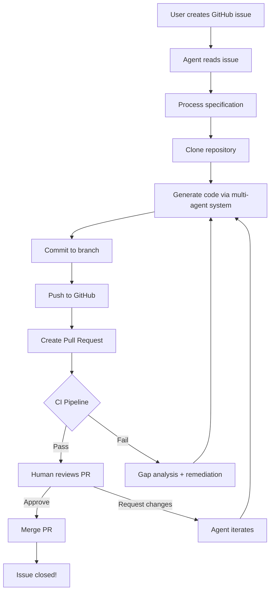

# GitHub Integration Guide

LilAgent now features **native GitHub integration** for issue-driven development with human-in-the-loop feedback.

## Overview

Instead of working with local specification files, you can now:
1. Create a GitHub issue describing what you want to build
2. Run `lilagent-github process <issue-number>`
3. Agent generates code and creates a Pull Request
4. CI runs automatically (if configured)
5. You review and provide feedback via PR comments
6. Agent responds and iterates based on your feedback
7. Merge when ready!

## Complete Workflow



## Setup

### 1. Create GitHub Personal Access Token

1. Go to https://github.com/settings/tokens
2. Click "Generate new token (classic)"
3. Name: "LilAgent"
4. Scopes: Select **`repo`** (full control of repositories)
5. Click "Generate token"
6. Copy the token (starts with `ghp_`)

### 2. Configure Environment

Add to your `.env` file:

```bash
# GitHub Integration
GITHUB_TOKEN=ghp_your_token_here
GITHUB_REPO=your-username/your-repo
GITHUB_DEFAULT_BRANCH=main

# LLM Configuration (use free tier!)
OPENAI_API_KEY=your-openrouter-key
OPENAI_API_BASE=https://openrouter.ai/api/v1
NORMALIZER_MODEL=google/gemma-2-9b-it:free
AGENT_MODEL=meta-llama/llama-3.1-70b-instruct:free
```

### 3. Prepare Your Repository

Your repository should have:
- ✅ A default branch (main or master)
- ✅ Issues enabled (Settings → Features → Issues)
- ✅ Optional: GitHub Actions workflow for CI

## CLI Commands

### Process an Issue

```bash
lilagent-github process <issue-number>

# With custom branch name
lilagent-github process 123 --branch feature/my-feature

# Process and monitor for feedback
lilagent-github process 123 --monitor --monitor-duration 120
```

**What happens:**
1. Reads issue description as specification
2. Processes spec (normalize → enhance)
3. Clones repository to temp directory
4. Generates code using multi-agent system
5. Commits all changes
6. Pushes to new branch
7. Creates Pull Request
8. Comments on issue with PR link
9. Monitors CI status
10. Optionally waits for user feedback

### Monitor an Existing PR

```bash
lilagent-github monitor <pr-number>

# Monitor for longer period
lilagent-github monitor 456 --duration 180
```

**What happens:**
- Checks PR for new comments from users
- Responds to feedback
- Can trigger re-implementation based on instructions
- Monitors CI status

### Show Setup Instructions

```bash
lilagent-github setup
```

Displays step-by-step setup guide.

## How It Works

### Issue Processing

When you run `lilagent-github process 123`:

**Step 1: Issue as Specification**
- Reads issue title and body
- Combines into specification text
- Comments on issue: "Processing started..."

**Step 2: Specification Enhancement**
- Normalizes language (removes informal/emotional content)
- Enhances with structured template
- Creates comprehensive spec

**Step 3: Repository Setup**
- Clones your repository
- Saves enhanced spec as `SPECIFICATION.md`
- Sets up working directory

**Step 4: Implementation**
- Runs full multi-agent workflow:
  - Planning agent creates task breakdown
  - Coder generates implementation
  - Reviewer ensures quality
  - UAT validates against spec
  - Gap analyst handles failures
  - Documentation agent creates docs
- Comments on issue with progress updates

**Step 5: Git Operations**
- Creates branch: `lilagent/issue-{number}`
- Commits all generated code
- Pushes to GitHub
- Updates issue with branch info

**Step 6: Pull Request Creation**
- Creates PR from branch to main
- PR title: "Implement: {issue title}"
- PR body includes:
  - Link to issue
  - Implementation summary
  - UAT status
  - Testing instructions
- Sets as draft if UAT failed
- Ready for review if UAT passed

**Step 7: CI Integration**
- Waits for CI to start
- Fetches CI status via GitHub API
- Comments on PR with results:
  - ✅ All checks passed
  - ❌ Failures with details
  - ⏳ Still running
- Can trigger remediation if CI fails

**Step 8: Human Feedback**
- Monitors PR for comments
- Responds to questions
- Can iterate based on change requests

## CI Integration

### What "Environment" Means

In the original exercise, "environment" refers to **GitHub Actions CI pipeline**.

The UAT agent considers implementation successful when:
1. Code is generated
2. Tests pass locally
3. **CI pipeline passes on GitHub**

### Setting Up CI

Place this in `.github/workflows/ci.yml` in your repository:

```yaml
name: CI

on:
  pull_request:
    branches: [main]

jobs:
  test:
    runs-on: ubuntu-latest
    steps:
      - uses: actions/checkout@v4
      - uses: actions/setup-python@v5
        with:
          python-version: '3.11'
      - name: Install dependencies
        run: |
          pip install -e .
      - name: Run tests
        run: |
          pip install pytest
          pytest
```

See `docs/github-actions-example.yml` for comprehensive template.

### How UAT Agent Uses CI

```python
# After creating PR
commit = repo.get_commit(pr.head.sha)
ci_status = commit.get_combined_status()

if ci_status.state == "success":
    # ✅ Implementation complete
elif ci_status.state == "failure":
    # ❌ Trigger gap analysis
    # Identify failing checks
    # Create remediation plan
    # Re-run implementation
```

**Result:** Agent only considers task complete when CI passes.

## Agent Tools for GitHub

The system provides these GitHub tools to agents:

| Tool | Description | Used By |
|------|-------------|---------|
| `get_issue` | Read issue details and comments | All agents |
| `comment_on_issue` | Add comment to issue | Planning, UAT |
| `create_pull_request` | Create PR from branch | UAT |
| `get_pull_request` | Read PR details, comments, CI status | UAT, Monitor |
| `comment_on_pr` | Add comment to PR | UAT, Monitor |
| `push_to_github` | Commit and push code | Coder |

### Tool Access Control

Different agents get different tools:

- **Planning Agent**: Can comment on issues to ask questions
- **Coder Agent**: Can push code to GitHub
- **UAT Agent**: Can create PRs, check CI, comment on results
- **Other agents**: No GitHub tools (work offline)

## Human-in-the-Loop Patterns

### Pattern 1: Clarification Questions

**Agent is stuck on ambiguous spec:**

```
Agent (on issue):
> 🤔 I need clarification on database choice.
>
> The spec mentions "scalable database" but doesn't specify which one.
>
> Options:
> - PostgreSQL (relational, ACID)
> - MongoDB (document store)
> - SQLite (embedded, simple)
>
> Which should I use?
```

**User responds:**
```
User (on issue):
> Use PostgreSQL for production scalability.
```

**Agent continues:**
```
Agent (on issue):
> ✅ Thank you! Proceeding with PostgreSQL.
```

### Pattern 2: Code Review Feedback

**User reviews PR:**

```
User (on PR):
> The error handling in api.py line 45 should catch
> more specific exceptions instead of broad Exception.
```

**Agent responds:**

```
Agent (on PR):
> ✅ Good catch! I'll update the error handling to catch
> specific exceptions. Let me push an update.

[Agent updates code and pushes]

Agent (on PR):
> Updated! Now catching ValueError and KeyError specifically.
> Please review api.py:45-52.
```

### Pattern 3: CI Failure Feedback

**CI fails:**

```
Agent (on PR):
> ❌ CI Status: FAILURE
>
> Failed checks:
> - **pytest**: 2 tests failed
>   - test_edge_case_empty_input
>   - test_invalid_date_format
>
> I'll analyze the failures and create a fix.
```

**Agent runs gap analysis → remediation → pushes fix**

```
Agent (on PR):
> ✅ Pushed fix in commit abc123
>
> Changes:
> - Added handling for empty input
> - Improved date validation
>
> CI should pass now.
```

## Example: Complete Flow

### Step 1: Create Issue

Create issue #42 in your repo:

**Title:** CLI Calculator
**Body:**
```markdown
Build a command-line calculator.

Requirements:
- Add, subtract, multiply, divide
- Handle division by zero
- Accept arguments: calculator add 5 3
- Include tests
```

### Step 2: Run Agent

```bash
lilagent-github process 42
```

**Agent output:**
```
🔄 Processing GitHub Issue #42
📋 Title: CLI Calculator

📝 Step 1/2: Normalizing specification language...
📋 Step 2/2: Enhancing specification with template...
✅ Specification processed

🚀 Running multi-agent implementation...
👨‍💻 Coder working...
🔍 Reviewer evaluating...
✅ Code review APPROVED!

🧪 UAT agent testing implementation...
✅ UAT PASSED!

📤 Pushing to branch: lilagent/issue-42
✅ Pull Request created: #43
```

### Step 3: Check GitHub

**On Issue #42:**
```
🤖 LilAgent commented:
✅ Pull Request created!
🔗 PR #43: https://github.com/you/repo/pull/43

I'll monitor for CI results and your feedback!
```

**On PR #43:**
```
Created by lilagent-bot

## 🤖 Auto-generated by LilAgent

Implements requirements from issue #42.

### CI Status
✅ All checks passed!

Closes #42
```

### Step 4: Review and Merge

You review the code, everything looks good:

```bash
# Test locally if you want
git checkout lilagent/issue-42
pytest
python -m calculator add 5 3
# Output: 8

# Merge via GitHub UI
```

**Done!** Issue #42 closed, feature implemented, tested, and merged.

## Best Practices

### For Issues

**✅ Good:**
```markdown
# Password Generator CLI

Build a CLI tool that generates secure passwords.

Requirements:
- Length configurable (default 16)
- Include uppercase, lowercase, numbers, symbols
- Option to exclude ambiguous characters (0, O, l, 1)
- Copy to clipboard
- Tests for randomness and requirements

Technical:
- Python 3.11+
- Use secrets module (not random)
- Installable via pip
```

**❌ Too vague:**
```markdown
make me a password tool that's good
```

**Fix:** Add specific requirements, edge cases, technical constraints

### For PR Comments

**✅ Specific feedback:**
```markdown
Line 23 in auth.py:
This should use constant-time comparison for security.
Replace `==` with `secrets.compare_digest()`
```

**❌ Vague:**
```markdown
The security isn't good
```

### For CI Setup

**✅ Clear failure messages:**
```yaml
- name: Run tests
  run: pytest -v  # Verbose output
```

**❌ Silent failures:**
```yaml
- name: Run tests
  run: pytest  # No context on failure
```

## Troubleshooting

### "Permission denied" when creating PR

**Cause:** GitHub token lacks repo scope

**Fix:**
1. Go to https://github.com/settings/tokens
2. Edit your token
3. Ensure **`repo`** scope is checked
4. Update `GITHUB_TOKEN` in `.env`

### "Branch already exists"

**Cause:** Previous run created the branch

**Fix:**
```bash
# Option 1: Use custom branch name
lilagent-github process 42 --branch feature/calc-v2

# Option 2: Delete old branch
git push origin --delete lilagent/issue-42
```

### Agent doesn't respond to PR comments

**Cause:** Monitoring not enabled

**Fix:**
```bash
# Run with monitoring
lilagent-github process 42 --monitor

# Or monitor separately
lilagent-github monitor <pr-number>
```

### CI status shows "pending" forever

**Cause:** CI didn't start or webhook issue

**Fix:**
1. Check Actions tab in GitHub
2. Ensure workflow file exists: `.github/workflows/ci.yml`
3. Check workflow runs on pull_request events
4. Try manual re-run in GitHub Actions

## Advanced Usage

### Custom Branch Naming

```bash
lilagent-github process 42 --branch feature/calculator-improvements
```

### Long-Running Monitoring

```bash
# Monitor for 4 hours
lilagent-github monitor 43 --duration 240
```

### Batch Processing

```bash
# Process multiple issues
for issue in 42 43 44; do
  lilagent-github process $issue
done
```

### Integration with CI/CD

```yaml
# .github/workflows/auto-implement.yml
name: Auto-implement labeled issues

on:
  issues:
    types: [labeled]

jobs:
  implement:
    if: github.event.label.name == 'lilagent'
    runs-on: ubuntu-latest
    steps:
      - uses: actions/checkout@v4
      - name: Setup lilagent
        run: |
          pip install -e .
      - name: Process issue
        env:
          GITHUB_TOKEN: ${{ secrets.GITHUB_TOKEN }}
          GITHUB_REPO: ${{ github.repository }}
          OPENAI_API_KEY: ${{ secrets.OPENAI_API_KEY }}
          OPENAI_API_BASE: ${{ secrets.OPENAI_API_BASE }}
        run: |
          lilagent-github process ${{ github.event.issue.number }}
```

Now issues labeled with "lilagent" auto-trigger implementation!

## Security Considerations

### Token Permissions

**Minimum required:**
- `repo` scope for private repos
- `public_repo` for public repos only

**Never share tokens:**
- Don't commit `.env` to git
- Use GitHub Secrets for CI workflows
- Rotate tokens periodically

### Code Review

**Always review generated code:**
- Check for security vulnerabilities
- Validate external dependencies
- Review credential handling
- Test edge cases

**Agent limitations:**
- May not catch all security issues
- Can introduce dependencies with CVEs
- Might hard-code secrets if spec mentions them

## Cost Considerations

### With Free Models

**OpenRouter free tier:**
- No cost for generation
- May have rate limits
- Good for testing and learning

**GitHub:**
- Free for public repos
- Free Actions minutes for public repos
- Private repos: depends on plan

### With Paid Models

**Typical costs per issue:**
- Small feature: $0.25 - $1.00
- Medium feature: $1.00 - $5.00
- Large feature: $5.00 - $15.00

**Ways to reduce costs:**
- Use free models for normalization
- Clear, detailed specifications (fewer iterations)
- Good CI setup (catch issues early)

## Summary

GitHub integration transforms LilAgent from a local tool to a **collaborative development system**:

✅ **Issue-driven**: Work starts from GitHub issues
✅ **Automated**: Creates PRs automatically
✅ **CI-aware**: Monitors and responds to test results
✅ **Interactive**: Human feedback drives iteration
✅ **Professional**: Follows standard GitHub workflows

**Perfect for:**
- Open source projects
- Team collaboration
- Learning agentic development
- Rapid prototyping

**Get started:**
```bash
lilagent-github setup
```

Happy coding! 🚀
