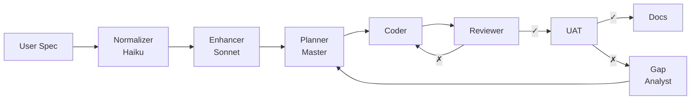
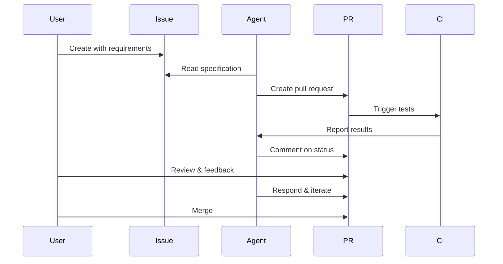

# 🤖 LilAgent

## Multi-Agent Spec-to-Code System

*Generate installable software packages from plain-language specifications*

**Powered by:**
- 🧠 Multi-agent architecture (CrewAI)
- 🔄 Dual feedback loops
- 📝 Spec-driven development
- 🐙 GitHub integration

---

## 🎯 The Problem

**Traditional coding agents:**
- ❌ Single monolithic agent
- ❌ Context pollution from tool calls
- ❌ No quality gates
- ❌ Poor separation of concerns
- ❌ Repeated tool calls waste tokens

---

## ✨ The LilAgent Solution

**Multi-agent architecture with:**
- ✅ 8 specialized agents, focused roles
- ✅ Context isolation (master never sees tool calls)
- ✅ Dual feedback loops (quality gates)
- ✅ Script-first strategy (10x fewer tool calls)
- ✅ Human-in-the-loop via GitHub PRs
- ✅ Gap analysis & adaptive replanning

---

## 🏗️ System Architecture



**Key insight:** Master agent has **NO** coding tools → clean context

---

## 👥 The 8 Specialized Agents

| Agent | LLM | Role | Tools |
|-------|-----|------|-------|
| **Spec Normalizer** | Haiku | Clean language | None |
| **Spec Enhancer** | Sonnet | Fill template | None |
| **Planning** | Sonnet | Orchestrate | Webhook only |
| **Coder** | Sonnet | Implement | All tools |
| **Reviewer** | Sonnet | Code quality | Read only |
| **UAT** | Sonnet | Validate | Read + Exec |
| **Gap Analyst** | Sonnet | Analyze failures | None |
| **Documentation** | Sonnet | Write docs | Read + Write |

---

## 🔄 Dual Feedback Loops

### Inner Loop: Coder ↔ Reviewer
**Purpose:** Ensure code quality before moving forward

```
┌─────────┐     ┌──────────┐
│  Coder  │ ──→ │ Reviewer │
│  Agent  │ ←── │  Agent   │
└─────────┘     └──────────┘
  Max 3 iterations
```

**Result:** Only approved code reaches UAT

---

## 🔄 Dual Feedback Loops (cont.)

### Outer Loop: Planner → UAT
**Purpose:** Ensure implementation matches specification

```
┌──────────┐     ┌─────┐     ┌────────────┐
│ Planning │ ──→ │ UAT │ ──→ │    Gap     │
│  Agent   │ ←── │     │ ←── │  Analyst   │
└──────────┘     └─────┘     └────────────┘
  Max 2 iterations
```

**Gap Analyst identifies:**
- Missing features
- Specification drift
- Failed tests
- Documentation gaps

---

## 📜 Script-First Strategy

### The Problem
```python
# ❌ BAD: Repeated tool calls (20+ calls)
for file in files:
    content = read_file(file)
    new_content = content.replace("foo", "bar")
    write_file(file, new_content)
```

### The Solution
```python
# ✅ GOOD: Script (2 calls)
write_file("scripts/rename.py", script)
execute_command("python scripts/rename.py")
```

**Benefits:** 10x fewer tokens, guaranteed consistency

---

## 🐙 GitHub Integration

**Issue-Driven Development:**

1. User creates GitHub issue
2. Agent reads issue as specification
3. Agent generates code
4. Agent creates Pull Request
5. CI runs automatically
6. Agent monitors CI and responds
7. Human reviews and comments
8. Agent iterates based on feedback

---

## 🐙 GitHub Workflow



---

## 💰 Cost Optimization

### Spec Normalization: Haiku (cheap)
- Simple language cleanup
- ~$0.10 per 1M tokens

### All Other Agents: Sonnet (smart)
- Complex reasoning required
- ~$1.00 per 1M tokens

### FREE Option: OpenRouter
```bash
NORMALIZER_MODEL=google/gemma-2-9b-it:free
AGENT_MODEL=meta-llama/llama-3.1-70b-instruct:free
```

**Total cost: $0.00** 🎉

---

## 📊 Specification Pipeline

### Input: Informal user request
```markdown
im so frustrated! make me a booking website
that doesnt suck
```

### After Normalization:
```markdown
User expresses need for a reliable booking
management web application
```

### After Enhancement:
**Structured 8-section specification:**
- Project overview
- Functional requirements
- Technical requirements
- Quality standards
- Acceptance criteria
- And more...

---

## 🎯 Key Innovations

1. **Master-Only Delegation**
   - Planning agent has NO coding tools
   - Context stays clean

2. **Script-First Doctrine**
   - Explicit prompt engineering
   - Prefer scripts over tool spam

3. **Gap-Driven Replanning**
   - UAT failures → analysis → remediation

4. **Cheap Normalizer**
   - Haiku for simple cleanup
   - Saves significant costs

---

## 📦 What Gets Generated?

Complete installable package:

```
output-directory/
├── SPECIFICATION.md      # Enhanced spec
├── README.md             # Usage docs
├── pyproject.toml        # Package config
├── src/your_package/     # Source code
│   ├── __init__.py
│   ├── main.py
│   └── ...
└── tests/                # Test suite
    └── test_*.py
```

**Ready to:**
- `pip install -e .`
- Run tests
- Use immediately

---

## 🚀 Usage Examples

### Local Mode
```bash
# Create spec.md with your requirements
lilagent spec.md ./output-dir

# Test the generated package
cd output-dir
pip install -e .
```

### GitHub Mode
```bash
# Process issue #123
lilagent-github process 123

# Monitor PR for feedback
lilagent-github monitor 456 --duration 120
```

---

## 🛠️ Technical Stack

**Frameworks:**
- **CrewAI**: Multi-agent orchestration
- **LangChain**: LLM SDK integration
- **PyGithub**: GitHub API
- **Typer**: CLI with rich output

**LLM Support:**
- Anthropic (Claude)
- OpenAI (GPT)
- OpenRouter (many free models!)
- Custom proxies

---

## 📈 Observations & Learnings

### What Worked Well ✅
- Context isolation prevents pollution
- Dual loops catch most issues
- Script-first saves tokens
- Gap analysis improves quality

### Failure Modes ⚠️
- Task extraction can be fragile
- Iteration limits needed (cost control)
- Some ambiguity remains even after enhancement
- Agents sometimes forget they have tools

---

## 🔮 Future Improvements

### Short-term
- Checkpoint system (resume from failures)
- Cost tracking dashboard
- Structured output (JSON task breakdown)
- Spec template validation

### Long-term
- Parallel task execution
- Spec pattern library
- Meta-learning (optimize agent selection)
- Multi-language support

---

## 📊 Cost Comparison

| Provider | Model | Typical Package Cost |
|----------|-------|---------------------|
| **OpenRouter (free)** | Llama 3.1 70B | **$0.00** |
| OpenRouter (paid) | Claude Sonnet 4 | ~$0.50-$2.00 |
| Direct Anthropic | Claude Sonnet 4 | ~$0.50-$2.00 |
| Direct OpenAI | GPT-4o | ~$1.00-$3.00 |

💡 **Pro tip:** Start with free tier, upgrade for production

---

## 🎓 Educational Value

**This project demonstrates:**
- Multi-agent system design
- Context management strategies
- Feedback loop implementation
- Prompt engineering techniques
- GitHub API integration
- CI/CD integration patterns
- Cost optimization strategies

**Perfect for:**
- Learning agentic systems
- Understanding LLM workflows
- Studying code generation
- Exploring automation

---

## 🔧 Setup in 5 Minutes

```bash
# 1. Clone
git clone <repo> && cd lilagent

# 2. Install
poetry install

# 3. Configure (free option!)
cp .env.example .env
# Edit with OpenRouter key

# 4. Run
lilagent tests/fixtures/calculator_spec.md /tmp/test

# 5. Celebrate! 🎉
```

**Free tier:** No credit card required

---

## 💡 Use Cases

### Perfect for:
- ✅ Learning projects
- ✅ Prototypes
- ✅ CLI tools
- ✅ Libraries
- ✅ REST APIs
- ✅ Data pipelines

### Not ideal for:
- ❌ Large existing codebases
- ❌ Complex distributed systems
- ❌ Projects requiring deep domain expertise
- ❌ Real-time/embedded systems

---

## 🌟 Key Takeaways

1. **Specialization beats generalization**
   - 8 focused agents > 1 do-everything agent

2. **Context is precious**
   - Isolation prevents pollution
   - Master stays clean

3. **Quality gates matter**
   - Dual loops catch issues early
   - Less waste, better results

4. **Scripts > Tools**
   - 10x efficiency gain
   - Consistency guaranteed

---

## 📚 Documentation

**Included:**
- `README.md` - Complete guide
- `QUICKSTART.md` - 5-minute setup
- `docs/OPENROUTER_SETUP.md` - Free LLM access
- `docs/github-actions-example.yml` - CI template
- `docs/PRESENTATION.md` - This slide deck

**Architecture diagrams:**
- Mermaid flowcharts
- Sequence diagrams
- System architecture

---

## 🤝 Contributing & Feedback

**This was a technical exercise, but:**
- Code is production-ready
- Architecture is sound
- Free tier makes it accessible

**Want to improve it?**
- Add support for more languages
- Implement checkpointing
- Build a web UI
- Add more agent specializations

**Questions?**
- Check the README
- Review the code
- Open an issue

---

## 🎬 Demo Time!

Let's see it in action...

```bash
# Create a simple spec
cat > my-spec.md << 'EOF'
# To-Do CLI

Build a command-line to-do list manager.

Requirements:
- Add, list, complete, and delete tasks
- Save to JSON file
- Support priorities
- Include tests
EOF

# Run LilAgent
lilagent my-spec.md ./todo-app
```

---

## 🏆 Reflection: What I'd Do Differently

**If starting over:**
1. Test-first approach (minimal pipeline → iterate)
2. Prompt engineering after observing behavior
3. Simpler tool protocol
4. Spec template from user research
5. Structured task decomposition

**The biggest win:**
> Context isolation for master agent
> *This single decision made everything else work*

---

## 🚀 The Future of Agentic Development

**LilAgent shows:**
- Multi-agent systems are practical
- Free tier makes it accessible
- Spec-driven development works
- GitHub integration enables collaboration

**What's next:**
- More specialized agent roles
- Learning from past successes/failures
- Better human-in-the-loop patterns
- Cross-language support

**The vision:**
> Every developer has an AI team

---

## 📞 Get Started Today

```bash
# Clone the repository
git clone <your-repo-url>

# Read the docs
cat README.md

# Try the free tier
docs/OPENROUTER_SETUP.md

# Build something!
lilagent your-idea.md ./output
```

**Remember:** Start simple, iterate, learn!

---

# Thank You! 🙏

## Questions?

**Built with:**
- 🧠 CrewAI for orchestration
- 🔗 LangChain for LLM integration
- 🐍 Python 3.11+
- 🐙 GitHub for collaboration
- 💡 Claude Sonnet 4 for intelligence

**Free to try, easy to deploy, fun to use!**

---

## Appendix: System Prompts

**Each agent has a detailed system prompt (40-50 lines):**

- **Planning Agent**: "You NEVER write code..."
- **Coder Agent**: "Prefer scripts for multi-file operations..."
- **Reviewer Agent**: "Output APPROVED or CHANGES_REQUESTED..."
- **UAT Agent**: "Check spec compliance and CI status..."

**Prompt engineering is critical:**
- Explicit constraints
- Clear examples
- Decision frameworks
- Success criteria

---

## Appendix: Token Efficiency

**Without script-first:**
```
Rename function across 10 files:
- 10 × read_file = 10 calls
- 10 × write_file = 10 calls
- Total: 20 calls, ~50k tokens
```

**With script-first:**
```
Create rename script:
- 1 × write_file (script)
- 1 × execute_command
- Total: 2 calls, ~5k tokens
```

**Savings: 90% fewer tokens!**

---

## Appendix: Architecture Patterns

**Design patterns used:**
1. **Hierarchical delegation** (master → sub-agents)
2. **Strategy pattern** (script-first strategy)
3. **Template method** (spec template)
4. **Observer pattern** (CI monitoring)
5. **Chain of responsibility** (feedback loops)

**Why these matter:**
- Proven patterns from software engineering
- Applied to agentic systems
- Makes system predictable and maintainable

